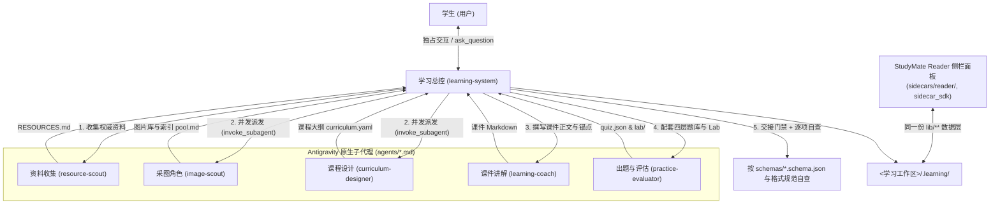

# 在 Google Antigravity 中使用 StudyMate

StudyMate 的 Google Antigravity 版本是面向 Antigravity 架构的原生多智能体插件包。它把 StudyMate 的学习工作流、课件阅读端与 Antigravity 的原生能力（子智能体机制 `invoke_subagent`、结构化交互模态 `ask_question`、安全沙箱 `run_command`）装在一起：

- **学习工作流**：主智能体（学习总控）+ 5 个专属后台子智能体，按「资料 → 采图 → 大纲 → 课件 → 题库/实验」推进。
- **StudyMate Reader 侧栏面板**：插件自带一个原生 Sidecar 阅读端，在 Antigravity 侧栏打开 `sidecar://studymate/reader/` 就能读课件、作答、标注、记笔记与跑实验。它读写的就是同一个学习工作区，与 DSH 阅读端是同一份渲染代码与数据层。
- **离线导出（补充）**：没有 Antigravity 的机器、或想存档时，用 `npx -y @yunmiao/studymate@latest export` 导一份自包含静态页面。

---

## 1. 架构总览

StudyMate 在 Antigravity 中采用 **主智能体（学习总控）+ 5 个专属后台子智能体 + 一个原生侧栏阅读端** 的设计：



- **主智能体（`learning-system`）**：全局学习规划、用户对话通道、调度子代理、档案管理、交接门禁与逐项自查。
- **5 个专属子智能体（`agents/`）**：
  - `resource-scout`：检索权威教材、官方文档与行业标准，产出资源清单与 `## Gaps`。
  - `image-scout`：抓取高质量概念图与流程图，校验尺寸格式，维护 7 列表头索引。
  - `curriculum-designer`：构建知识依赖拓扑有向无环图（DAG），制定标准大纲与实验课里程碑。
  - `learning-coach`：撰写教材级深度课件正文、配图与题目锚点。
  - `practice-evaluator`：全系统题目与评估的唯一 Owner，设计四层练习、整套 Lab 任务，基于真实运行证据核验与批改。
- **12 个完整 Skill 规范（`skills/`）**：全部采用标准规范 Frontmatter，在 Antigravity 中完整可见与常驻。
- **原生阅读端（`sidecars/reader/`）**：宿主 `sidecar_sdk` 声明的辅助窗格视图，面板地址 `sidecar://studymate/reader/`。

---

## 2. 安装、部署与更新

### 方式一：一条命令构建并安装（推荐）

```bash
npx -y @yunmiao/studymate@latest build-antigravity --install
```

在 StudyMate 仓库里工作时等价于：

```bash
node bin/studymate.mjs build-antigravity --install
```

该命令会自动：

1. 编译适配 Antigravity 的 5 个 Subagent、12 个 Skill 规范与交互协议。
2. 打包 schema、工作区数据骨架、文档与 logo——**没有引擎脚本**（Python 引擎随 #83 退役，校验按自查清单做）。
3. 把 Sidecar 阅读端封进 `sidecars/reader/`：`main.mjs`、`host.js`、`boot.js`、`index.html`，加上构建期拷贝的 `engine/lib/**`、`engine/bin/typescript-runtime.mjs`、`client/` 与确定性的 React `vendor/`。
4. 原子替换安装到 Antigravity 插件目录：`~/.gemini/config/plugins/studymate`。

目标目录里已有非 StudyMate 文件时会拒绝安装（不会清空已有内容）；空目录或上一次构建的产物可以直接覆盖。要装到别处用 `--output <目录>`。

### 方式二：构建分发 ZIP 包手动导入

```bash
npm run build:antigravity
```

构建产物位于：

- `dist/antigravity/studymate/`（完整插件解压目录）
- `dist/antigravity/studymate-antigravity.zip`（分发安装包）

通过 Antigravity IDE 的插件管理器选择导入该 ZIP 即可。

### 依赖环境

- **阅读端**：随插件发货，不需要另装什么。React 在构建期已被封进 `vendor/`；只有当产物里 `vendor/` 被删掉、且这台机器确实没有 React 时，`/vendor/*` 路由才会返回 404 `react-missing`（面板会提示怎么补）。
- **离线导出**：`npx -y @yunmiao/studymate@latest export` 需要 Node 与一份 React（`npm i -g react react-dom`，或设 `STUDYMATE_REACT_DIR`）。

---

## 3. 使用说明与学习流程

### 1. 意图自动激活

得益于内置的 `rules/AGENTS.md` 规则，你在 Antigravity 对话中只要表达学习意愿：

- *“我想学计算机网络”*
- *“我想学 C++ 打竞赛”*
- *“我不知道学什么，帮我选方向”*

系统会自动激活 `learning-system` 进入学习工作流；日常写代码、修 Bug、代码审查或普通开发请求**不会**误打扰。

### 2. 交互式开课盘问（`ask_question`）

总控会调用 Antigravity 原生的交互式卡片逐步确认核心信息：

1. **现实目标与期望深度**：了解 / 能独立做项目 (Recommended) / 精通。
2. **前置知识自评**：核心数学/编程前置能力核验。
3. **主线项目选择**：给出 3 个以上有明确差异的实践项目供学生挑选。
4. **实操实验载体**：按项目性质选定 Jupyter Notebook、源码与测试或命令行等。

整个过程一次一个决策，收到回答直接向下推进，不反复发送“是否开始”等冗余确认。

### 3. 多智能体协同推进

- **并发调度**：资料收集就绪后，总控通过 `invoke_subagent` 数组同时并发派发 `image-scout`（采图建池）与 `curriculum-designer`（设计大纲 DAG）。
- **串行制作**：讲解角色完成课件正文后，出题评估角色进场配套练习题库与 Lab 任务包。
- **事件驱动**：子代理在独立后台上下文中执行，宿主在完成后自动通知总控，全程零轮询、零卡顿。

### 4. 原生 StudyMate Reader 侧栏面板

插件把阅读端做成宿主原生 Sidecar（`sidecars/reader/sidecar.json`，入口 `SIDECAR_UI_ENTRYPOINT_AUX_PANE`）。安装后：

- 在 Antigravity 侧栏打开 `[StudyMate Reader](sidecar://studymate/reader/)`，或从插件面板里点开同名视图。
- 面板自动跟随当前 Antigravity 工作区（`window.sidecar.getWorkspaceUris()`）；工作区切换时面板不刷新，直接切到新工作区。
- 能做的事与 DSH 阅读端一致：读课件、作答判分（写回 `subjects/<slug>/attempts/<NNNN>-<节点id>.json`）、划选标注（`annotations/`）、无界笔记（`<ws>/.learning/studymate-notes/`）、跑实验、把当前段落一键发给 Antigravity 当前对话。
- 面板的写入栅栏与 DSH 一侧完全相同：`operationId` 幂等、`expectedVersion` 过期返回 409 `version-conflict`、路径越界直接 400。
- 变更感知用轮询（`/api/studymate/poll-version`），由 `host.js` 里的 `PollingEventSource` 实现。

面板不需要单独启动：宿主按 `sidecar.json` 拉起 `node main.mjs`，`restart_policy: always` 负责崩溃重启。

### 5. 课件呈现与伴学 Artifact

- **课件交付**：课件与题库生成后直接在阅读端面板里读；总控在对话里给出对应科目/节点，不再依赖本地 `file://` 链接。
- **伴学 Artifact**：总控会在 `<appDataDir>/brain/<conversation-id>/` 写入 Mermaid 知识依赖路线图或本课导读 Artifact，提供结构化伴学视图。

### 6. 局部答疑与打扰控制（`local-qa`）

在面板里阅读课件或做题遇到疑惑时，可以采用下面任一方式提问，总控会在 200 字内精准解答，不打断主线进度：

- **面板直连助教（`AntigravityAskBox`）**：在右侧课件中划选段落点击「就这段问一句」，或直接用面板内的问答框选择 **「发送到当前对话」**、**「新开答疑对话」** 或 **「塞进输入框」**。受限于 Antigravity `sidecar_sdk` 仅暴露投递接口而未向第三方 Sidecar 开放对话流渲染组件，**AI 的回答需在左侧 Antigravity 聊天区查看**（这与 DSH 原版在面板内直接嵌入子会话流有所不同）。
- **直接贴回对话**：也可直接把看不懂的段落贴回左侧对话并提问（如 *“这里没懂”*）。

误解记录（`misconceptions`）**只在有可观察证据时写**：讲解反馈里学生答错并定位到根源、或实验课验收暴露出错误理解。面板里的作答本身不直接写误解库——它答完就留在原地，由总控按证据判断要不要记一条（详见 `record-keeping` 技能）。

### 7. 离线导出（补充手段）

没有 Antigravity 的机器、或想把某一版课程存档时，跑：

```sh
npx -y @yunmiao/studymate@latest export
```

工作区按 `--workspace` → `$LEARN_WORKSPACE` → `~/.dsh/studymate-config.yaml` 里的 `workspace` → `~/StudyMate` 的顺序定位，通常什么都不用带。产物落在 `<学习工作区>/export/`：

- `index.html`：双击就能离线看（也可以在浏览器里用 `file://` 打开）。样式、公式、图片、题目都在这个目录里，**不联网、不需要 DSH**——页面跑的就是阅读端那一份渲染代码；
- 想只导一门科目：`--subject <slug>`；想换落点：`--out <目录>`；技能里要产物清单：`--json`。

导出需要一份 React：`npm i -g react react-dom`，或把 `STUDYMATE_REACT_DIR` 指到装着 react 的目录。缺了会明确告诉你装什么，不会产出一份打不开的页面。

---

## 4. 工作区与产物交接

- **学习工作区**：面板跟随 Antigravity 当前工作区的 URI；无头触发时按 `$STUDYMATE_WORKSPACE` / `$LEARN_WORKSPACE` → `~/.dsh/studymate-config.yaml` 的 `workspace` → `~/StudyMate` 解析。所有科目、大纲、课件、作答记录与跨科目共享记忆都在这里。
- **学习数据直接写工作区**：暂存模式已删（[ADR-0008](../adr/0008-删掉暂存模式.md)），没有「开场先在 `.studymate-stage/<slug>` 建课、收尾问落点再搬一次」这套机制。
- **产物交接用的科目内 `.stage/`**：子代理产物写入 `<subject_path>/.stage/<角色名>-<节点id>/deliver/<相对路径>`，服务的是交接门禁，不是权限。

---

## 5. 常见问题排查

- **安装后技能未加载**：确认插件已部署在 `~/.gemini/config/plugins/studymate`，重启 Antigravity IDE 即可重新扫描并注册全部 12 个 Skill 与 5 个 Agent。
- **侧栏里看不到 StudyMate Reader**：先确认 `sidecars/reader/sidecar.json` 在插件目录里、宿主版本支持 Sidecar 辅助窗格（`SIDECAR_UI_ENTRYPOINT_AUX_PANE`）；再确认 `node` 在宿主 PATH 上——宿主用它拉起 `main.mjs`。
- **面板白屏或提示 `react-missing`**：产物里的 `vendor/` 被删了，而机器上也没有可用的 React。重新安装插件即可恢复；或设 `STUDYMATE_REACT_DIR` 指到装着 `react`/`react-dom` 的目录。
- **面板看不到课件/笔记**：面板从 Antigravity 当前工作区读数据；确认工作区里已有 `.learning/subjects/`（空工作区会明确显示「还没有科目」）。也可以用 `$STUDYMATE_WORKSPACE` 显式指过去。
- **子代理运行报错**：走 `.stage/.../deliver/` 的交付先按 `deliver/` 清单自查（manifest 与文件一一对应、角色与节点对得上、路径不越界），再按对应领域的自查清单核对（大纲按 schema、图片库按七列索引、课件按内容格式与锚点）；任一阻断项未过都不合盘并打回重试。

---

## 6. 开发者维护与测试

改插件、Sidecar 适配层或阅读端数据路由后：

- `npm run test:antigravity`：Antigravity 专用回归——ZIP 导出、Agent 准则、12 技能 frontmatter、Manifest 官方键白名单、Sidecar 产物清单，以及 `sidecars/reader/main.mjs` 的 13 项契约测试（静态路由、vendor 兜底、library / attempts / annotations / reference / asset / tasks / status / notes / poll-version / math，加静态源码契约）。
- Sidecar 契约测试跑在**构建产物**上：先把插件构建到临时目录，再用 `module.registerHooks` 把裸模块 `sidecar_sdk` 指到 `scripts/tests/fixtures/sidecar-sdk-mock.mjs`，所以不需要真宿主环境。

门禁是哪条、静态层与全量回归什么关系，见 [CONTRIBUTING.md §本地验证](../../CONTRIBUTING.md#本地验证)与[测试说明](../../scripts/tests/README.md)。
